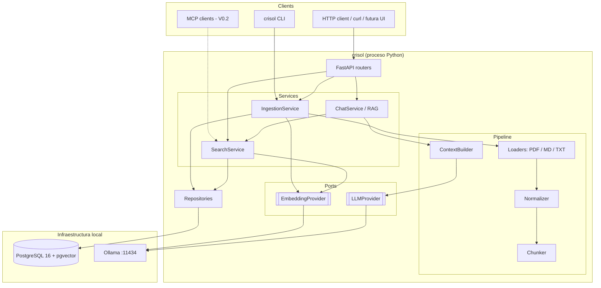
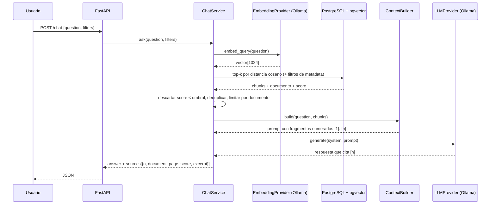
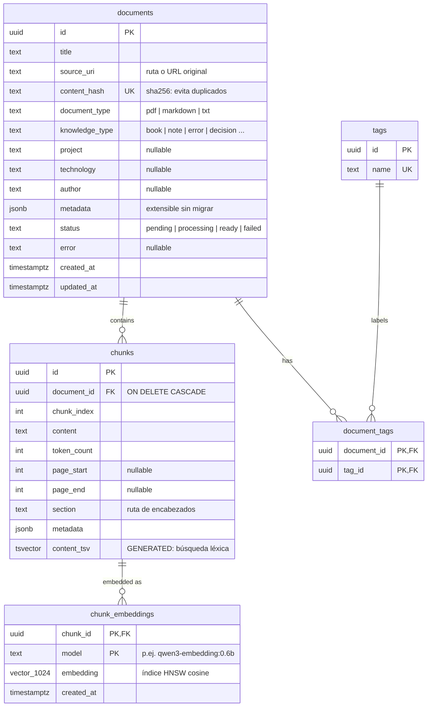

# El Crisol — Arquitectura V0.1

Documento vivo. Registra el diseño de la V0.1 y las decisiones que lo justifican.

## 1. Arquitectura propuesta

Un **monolito modular** en Python: un único proceso FastAPI más un CLI, sobre PostgreSQL + pgvector y Ollama. Sin colas, sin microservicios.

Tres ideas guían el diseño:

1. **Puertos pequeños para lo que cambiará.** `EmbeddingProvider`, `LLMProvider` y `DocumentLoader` son `Protocol`s de Python con una sola implementación en V0.1 (Ollama, Ollama, PDF/MD/TXT). Cambiar a OpenAI, Claude o Gemini será escribir una clase nueva y cambiar una variable de entorno.
2. **La lógica RAG es nuestra y visible.** Chunking, recuperación y construcción de contexto son funciones propias, cortas y testeadas. Se usan librerías solo para lo mecánico: extraer texto de PDF, hablar HTTP con Ollama y guardar vectores.
3. **PostgreSQL es la única fuente de verdad.** Documentos, chunks, embeddings, etiquetas y, más adelante, relaciones y memorias viven en la misma base. El índice vectorial es solo un índice más.

Capas (las dependencias van solo hacia abajo):

| Capa | Responsabilidad | Conoce |
|---|---|---|
| `api/` | HTTP: validar entrada y serializar salida | services |
| `services/` | Casos de uso: ingestar, buscar, chatear | domain, repositories, puertos |
| `domain/` | Modelos y reglas del conocimiento (sin I/O) | nada |
| `repositories/` | Consultas SQL/ORM | database |
| `infrastructure/` | Adaptadores: Postgres, Ollama, parsers | librerías externas |
| `core/` | Configuración, logging, errores | — |

## 2. Diagrama de componentes



## 3. Flujo de una consulta RAG (`POST /chat`)



Paso a paso:

1. **Embedding de la pregunta.** Se usa el mismo modelo que en la ingestión. Qwen3-Embedding añade una instrucción a las consultas; esa diferencia queda encapsulada en `embed_query` frente a `embed_documents`.
2. **Recuperación.** `ORDER BY embedding <=> :q LIMIT k` usando el índice HNSW, con filtros opcionales por `knowledge_type`, `project`, `technology` y `tags`.
3. **Selección.** Umbral mínimo de similitud y máximo de N chunks por documento, para que un libro de 600 páginas no acapare todo el contexto.
4. **Construcción de contexto.** Fragmentos numerados, cada uno con su título, página o sección, y un presupuesto de tokens.
5. **Generación.** El system prompt obliga a responder solo con el contexto, citar `[n]` y decir «no lo encuentro en tu conocimiento» cuando no hay base suficiente.
6. **Respuesta.** Las fuentes se devuelven siempre de forma estructurada, desde nuestros datos y no desde el texto del LLM, para que sean verificables.

## 4. Tecnologías

| Área | Elección | Motivo |
|---|---|---|
| Lenguaje | Python 3.12 (gestionado por `uv`) | Requisito; `uv` evita tocar el Python del sistema |
| API | FastAPI + Pydantic v2 + pydantic-settings | Requisito; tipado de extremo a extremo |
| ORM / migraciones | SQLAlchemy 2.0 (síncrono) + Alembic + psycopg 3 | Lo síncrono es más simple de depurar y testear; el cuello de botella es Ollama, no la base de datos |
| Vector store | pgvector 0.8 (imagen `pgvector/pgvector:pg16`) con índice HNSW y distancia coseno | Todo en Postgres |
| Embeddings | **`qwen3-embedding:0.6b`** vía Ollama (1024 dims, multilingüe, ~640 MB). Alternativa: `bge-m3` | Tus libros están en inglés y tus preguntas en español: hace falta un modelo multilingüe. Es pequeño para 8 GB de RAM |
| LLM local | **`qwen3:4b`** vía Ollama (~2,5 GB). Alternativa ligera: `llama3.2:3b` | Buen español y razonamiento para su tamaño; cabe junto al modelo de embeddings en 8 GB |
| PDF | PyMuPDF (`pymupdf`) | La mejor extracción con número de página. Licencia AGPL: sin problema para uso personal |
| Markdown | `python-frontmatter` + parser propio por encabezados | El frontmatter YAML aporta metadata (tipo, proyecto, tags); sirve para la bitácora de errores |
| HTTP a Ollama | `httpx` directo contra `/api/embed` y `/api/chat` | Sin SDK: se entiende exactamente qué se envía |
| Calidad | ruff, mypy (strict), pytest | — |

**Restricción del equipo:** MacBook M2 con **8 GB de RAM**. Docker Desktop (VM de unos 2 GB), Postgres, el modelo de embeddings y el LLM tienen que convivir. Recomendaciones: limitar la VM de Docker a unos 2 GB (Settings → Resources) y usar modelos de 4B como máximo. Si aun así hay presión de memoria, la alternativa es Postgres nativo con `brew install pgvector` sobre tu `postgresql@16` actual. El código no cambia; solo cambia `CRISOL_DATABASE_URL`.

## 5. Modelo inicial de base de datos



Decisiones de modelado:

- **Los embeddings van en una tabla aparte, con clave `(chunk_id, model)`.** Así se puede re-embeber con un modelo nuevo sin tocar los chunks y comparar ambos modelos antes de migrar.
- **`knowledge_type` y `status` son `text` validados por Pydantic, no `ENUM` de Postgres.** Añadir un tipo nuevo no requiere migración.
- **`metadata jsonb`** actúa como válvula de escape para campos específicos de cada fuente. Si un campo se consulta a menudo, se promueve a columna.
- **`content_tsv`** se crea desde el principio aunque la V0.1 solo busque por vectores. Activar la búsqueda híbrida más adelante no requerirá migrar datos.
- **Fuera de la V0.1, pero previsto:** `entities` y `relations` (sujeto, predicado, objeto, con chunk de evidencia) para el grafo de la V0.5; `conversations`, `messages` y `memories` para la V0.3; `retrieval_logs` para evaluar la calidad. Todas cuelgan de `documents` o `chunks` sin reestructurar nada.

## 6. Estructura del repositorio

Cambio respecto a la propuesta original: se usa `src/crisol/` en lugar de `app/`. El paquete se llama `crisol`, lo que permite que la API, el CLI y el futuro servidor MCP importen `crisol.services...` sin problemas de ruta. El `src/` evita que los tests importen código no instalado por accidente.

```text
crisol/
├── src/crisol/
│   ├── main.py                    # create_app()
│   ├── cli.py                     # crisol ingest|search|ask          (F7)
│   ├── core/                      # config, logging, exceptions
│   ├── api/
│   │   ├── routes/                # health, documents, knowledge, chat
│   │   └── schemas.py             # DTOs HTTP
│   ├── domain/                    # KnowledgeType, ParsedDocument, Chunk, SearchHit...
│   ├── services/                  # ingestion.py, search.py, chat.py
│   ├── rag/                       # normalizer.py, chunker.py, context_builder.py, prompts.py
│   ├── repositories/              # documents.py, chunks.py
│   ├── infrastructure/
│   │   ├── database/              # engine/session, ORM models
│   │   ├── embeddings/            # base.py (Protocol), ollama.py
│   │   ├── llm/                   # base.py (Protocol), ollama.py
│   │   └── loaders/               # base.py, pdf.py, markdown.py, text.py
│   └── mcp/                       # V0.2
├── migrations/                    # Alembic
├── tests/{unit,integration}/
├── data/inbox/                    # tus documentos (ignorados por git)
├── docker/postgres/init.sql       # CREATE EXTENSION vector
├── scripts/
├── docs/
├── docker-compose.yml
├── Makefile
├── pyproject.toml  uv.lock  .python-version
├── .env.example
└── README.md
```

## 7. Dependencias Python (se añaden en la fase que las necesita)

| Paquete | Fase | Para qué |
|---|---|---|
| fastapi, uvicorn[standard], pydantic, pydantic-settings | 1 | API y configuración |
| sqlalchemy, psycopg[binary], alembic, pgvector | 2–3 | Persistencia y vectores |
| pymupdf, python-frontmatter | 4 | Parsers |
| httpx | 6 | Cliente de Ollama |
| python-multipart | 7 | Subida de ficheros en `POST /documents` |
| typer | 7 | CLI |
| *dev:* pytest, httpx2, ruff, mypy | 1 | Calidad |

## 8. Riesgos y decisiones técnicas

1. **La dimensión del vector está fijada en el esquema.** `vector(1024)` ata la columna al modelo. Cambiar a un modelo con otra dimensión exige una columna o tabla nueva y re-embeber todo. Mitigaciones: se guarda `model` por embedding, hay un script de re-indexado y se elige un modelo de 1024 dimensiones, un tamaño habitual.
2. **8 GB de RAM.** Es el riesgo operativo principal (ver §4). Ollama descarga los modelos inactivos (`OLLAMA_KEEP_ALIVE`). La ingestión masiva y el chat conviene no ejecutarlos a la vez.
3. **La búsqueda solo vectorial falla con cadenas exactas.** Preguntas como «¿ya me pasó `RPC_ERROR`?» dependen de tokens literales que los embeddings difuminan. Por eso se crea `content_tsv` desde el día 1 y se planifica la búsqueda híbrida (vector + BM25, fusionados con RRF) en la fase 10, antes de la V0.2.
4. **Calidad de extracción de PDF.** Tablas, código y columnas se degradan. En V0.1 se acepta, se conserva el número de página para verificar y se registra cuántos caracteres salen por página para detectar PDFs escaneados (sin OCR por ahora).
5. **Ingestión larga.** Un libro de 600 páginas son unos 1.500 chunks, varios minutos de embeddings en un M2. V0.1: `POST /documents` devuelve `202` y procesa en un `BackgroundTask` con `status`; el CLI procesa en primer plano mostrando el progreso. No se introduce una cola de trabajos.
6. **Deduplicación.** Se usa `content_hash` (sha256 del fichero): reingestar el mismo archivo no duplica nada.
7. **Alucinación y citas.** Las fuentes se devuelven desde los datos recuperados, nunca se extraen del texto del LLM. El prompt exige responder «no encontrado» cuando no hay base.
8. **Licencia de PyMuPDF (AGPL).** No afecta al uso personal. Si algún día se distribuye, se sustituye por `pypdf` detrás del mismo `DocumentLoader`.
9. **Postgres local ya en el puerto 5432.** El contenedor se expone en el **5433** para no chocar con tu `postgresql@16` de Homebrew.
10. **Libros con copyright.** Se quedan en `data/`, fuera de git, y nunca salen del equipo salvo que se active un LLM cloud. Cuando ese LLM exista, el contexto enviado se registrará en el log.

## 9. Roadmap V0.1 (fases pequeñas, un commit o dos por fase)

| # | Fase | Entregable verificable | Commit |
|---|---|---|---|
| 1 | Bootstrap | `make check` en verde; `GET /health` responde | `chore: initialize project structure` |
| 2 | Infra Postgres | `docker compose up`, extensión `vector` activa, `/health` comprueba la base de datos | `feat: add postgres pgvector infrastructure` |
| 3 | Esquema | Modelos ORM y migración Alembic inicial; tablas creadas | `feat: add knowledge schema and migrations` |
| 4 | Loaders | PDF/MD/TXT → `ParsedDocument` (texto + páginas + metadata), tests con ficheros reales | `feat: add document loaders` |
| 5 | Normalizer + Chunker | Chunks con solapamiento que respetan encabezados y páginas; tests de bordes | `feat: implement chunking` |
| 6 | Embeddings | `OllamaEmbeddingProvider` real; test de integración contra Ollama | `feat: implement embedding service` |
| 7 | Ingestión | `IngestionService`, `POST/GET /documents`, `crisol ingest`; logs del pipeline | `feat: implement document ingestion` |
| 8 | Búsqueda semántica | `POST /knowledge/search` sobre pgvector con filtros | `feat: add semantic search` |
| 9 | RAG | `LLMProvider` (Ollama), `ContextBuilder`, `POST /chat` con fuentes | `feat: implement rag pipeline` |
| 10 | Endurecimiento | Búsqueda híbrida, carga de los tres libros y un set de 15–20 preguntas de evaluación | `feat: add hybrid search and eval set` |

Después: V0.2 MCP, V0.3 memoria, V0.4 Obsidian, V0.5 grafo, V0.6 web.

## 10. Fase 1 — Bootstrap (esta fase)

**Objetivo:** un esqueleto instalable, configurable, observable y testeado, sin lógica de negocio todavía.

Incluye:

- Repositorio git propio, `.gitignore` que protege `data/` y `.env`.
- `pyproject.toml` gestionado por `uv`, con Python 3.12 fijado en `.python-version`.
- Paquete `src/crisol` con la estructura de capas vacía y documentada.
- `core/config.py`: `Settings` con prefijo `CRISOL_`, validación y caché.
- `core/logging.py`: formato de texto o JSON, campos estructurados con `extra=` y uvicorn integrado.
- `core/exceptions.py`: jerarquía `CrisolError` traducida a HTTP en un único sitio.
- `main.py`: fábrica `create_app()` con middleware de request-id y duración.
- `GET /health`.
- Tests de health y configuración; `ruff`, `mypy --strict` y `pytest` en `make check`.

No incluye: base de datos, Ollama ni RAG. Llegan en las fases 2–9.
